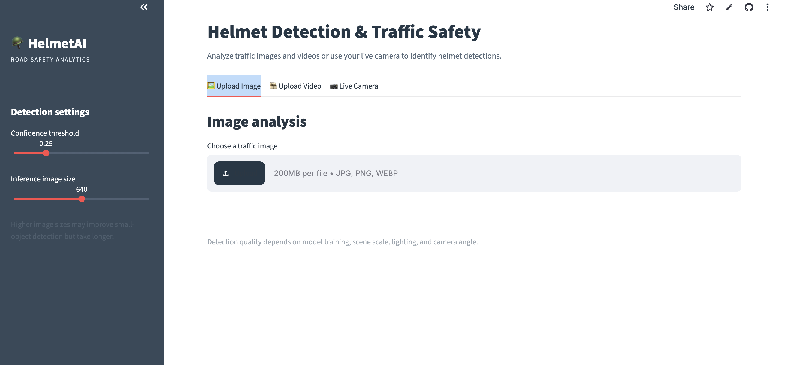
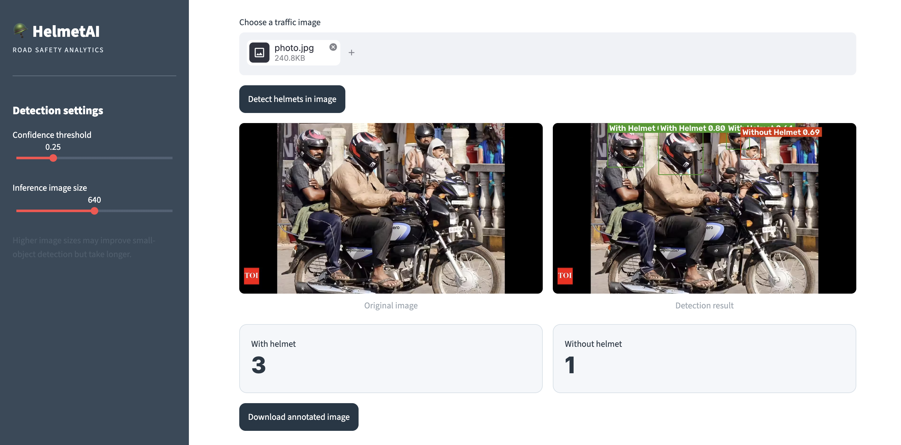
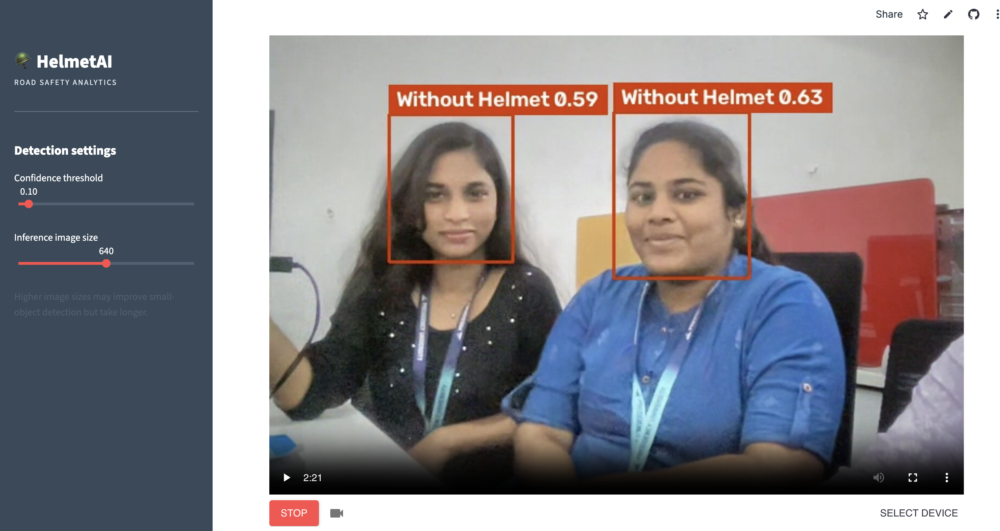
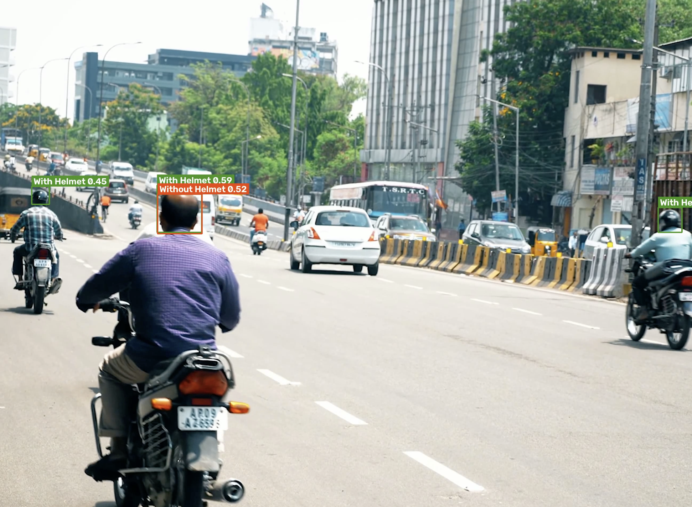

# 🪖 HelmetAI — Helmet Detection & Road Safety Analytics

HelmetAI is a computer-vision web application built to explore helmet detection in traffic scenes. It uses a trained YOLO model to predict **With Helmet** and **Without Helmet**, then draws bounding boxes and confidence scores over images or video frames.

<p align="center">
  <a href="https://helmet-detection-vileka-ai.streamlit.app/"><strong>🚀 Open the Live Demo</strong></a>
  &nbsp; · &nbsp;
  <a href="https://github.com/Vileka06/Helmet-Detection"><strong>Browse the Code</strong></a>
</p>

---

## 👀 See the app in action

The screenshots below show the application's interface and examples of model output. They are examples of the current application, not a guarantee that every prediction is correct.

### 1. Home screen

This is the main page. The sidebar contains the detection settings, and the tabs let you choose the type of input.



### 2. Detect helmets in an image

Choose **Upload Image**, select a traffic image, and click **Detect helmets in image**. The app shows the original image next to the annotated image. Colored boxes identify the model's predicted classes, and the metric cards count the predictions by class. Use **Download annotated image** to save the output.



### 3. Live camera

Open **Live Camera**, allow camera permission in the browser, and start the stream. The app runs the detector on camera frames and draws predictions on the video. Live processing also depends on your browser, network, and WebRTC connection.



### 4. Video detection

Choose **Upload Video**, select a supported video file, set the maximum duration and frame sampling rate, then click **Process video**. The app processes selected frames, builds an annotated MP4, displays the result, and provides a download when processing completes.



---

## ✅ What the application can do

- **Image detection:** process JPG, JPEG, PNG, and WEBP images.
- **Video detection:** analyze sampled video frames and create an annotated MP4.
- **Live camera:** run predictions on browser camera frames when the WebRTC connection works.
- **Detection controls:** adjust the confidence threshold and inference image size.
- **Visual output:** show bounding boxes, class labels, confidence scores, and per-class counts.
- **Download results:** save annotated images or processed videos.

## 🧭 Try the live demo

**[Launch HelmetAI](https://helmet-detection-vileka-ai.streamlit.app/)**

For the easiest first test:

1. Open the app and select **Upload Image**.
2. Choose a clear traffic photo that contains one or more motorcycle riders.
3. Click **Detect helmets in image**.
4. Compare **Original image** with **Detection result**.
5. Check the “With helmet” and “Without helmet” counts.
6. Click **Download annotated image** to save the result.

To try video, open **Upload Video** and process a short clip first. For live camera, use **Live Camera** and allow the browser to access your camera.

## 🧠 How detection works

1. **Input:** the app receives an uploaded image, video frame, or live camera frame.
2. **Inference:** the trained YOLO model predicts bounding boxes, class IDs, and confidence scores.
3. **Filtering:** the app applies the configured confidence threshold and overlap suppression to reduce duplicate predictions.
4. **Annotation:** OpenCV draws the boxes and labels on the image or frame.
5. **Results:** the app displays the annotated output, counts, and download option where applicable.

The application loads its trained weights from `models/best.pt`.

| Class ID | Label displayed |
| --- | --- |
| 0 | With Helmet |
| 1 | Without Helmet |

A confidence score is the model's confidence in a prediction, not a guarantee that the prediction is correct.

## 🖥️ Interface controls

| Control | What it changes |
| --- | --- |
| Confidence threshold | Higher values usually show fewer, stronger predictions; lower values may show more false positives. |
| Inference image size | Larger sizes can help with small objects but may take longer. |
| Analyze every Nth frame | In video mode, controls how often frames are sent to the detector. |
| Maximum video duration | Limits how much of the uploaded video is processed. |

## 🛠️ Technology used

| Technology | Role in the project |
| --- | --- |
| Python | Main application logic |
| Ultralytics YOLO | Object-detection model inference |
| OpenCV | Frame processing, box drawing, video input/output |
| NumPy | Image and frame arrays |
| Pillow | Image loading |
| Streamlit | Web interface |
| Streamlit WebRTC and PyAV | Browser camera streaming |
| Streamlit Community Cloud | Hosted live demo |

## 📁 Repository structure

```text
Helmet-Detection/
├── app.py
├── requirements.txt
├── README.md
├── models/
│   └── best.pt
└── screenshots/
    ├── homepage.png
    ├── image-detection.png
    ├── live-detection.png
    └── videodetection.png
```

## 💻 Run it locally

### 1. Clone the repository

```bash
git clone https://github.com/Vileka06/Helmet-Detection.git
cd Helmet-Detection
```

### 2. Create and activate a virtual environment

**macOS / Linux**

```bash
python3 -m venv .venv
. .venv/bin/activate
```

**Windows PowerShell**

```powershell
python -m venv .venv
.venv\Scripts\Activate.ps1
```

### 3. Install the dependencies

```bash
python -m pip install --upgrade pip
python -m pip install -r requirements.txt
```

### 4. Confirm the trained model is present

Make sure `models/best.pt` exists. The app expects that exact path and filename.

### 5. Run the application

```bash
python -m streamlit run app.py
```

Open the local URL printed in the terminal, normally `http://localhost:8501`.

## ☁️ Deployment

The project is hosted on Streamlit Community Cloud.

- **Live application:** [helmet-detection-vileka-ai.streamlit.app](https://helmet-detection-vileka-ai.streamlit.app/)
- **Entry point:** `app.py`
- **Dependencies:** `requirements.txt`

The live-camera feature requires browser camera permission and a working WebRTC connection. A camera preview alone does not guarantee that frames have reached the model for inference.

## ⚠️ Known limitations

This is an educational computer-vision project, and predictions can be wrong. Small or distant riders, blur, occlusion, lighting, camera angle, and crowded scenes can affect results. A model may also produce false positives—for example, interpreting a person's face or clothing as a helmet. Review the annotated output instead of treating each prediction as ground truth.

The screenshots are example outputs, not a formal benchmark. No accuracy, precision, recall, or mAP figure is claimed here. Those metrics should be added only after running a documented evaluation on a separate labelled test set.

## 🔭 Next improvements

- Evaluate the model on a separate labelled test set and publish measured metrics.
- Review false positives and missed detections, then improve the training data.
- Add automated tests for model loading and sample-image inference.
- Improve live-camera connection diagnostics and performance.


⭐ If this project helps you understand object detection, consider starring the repository.
